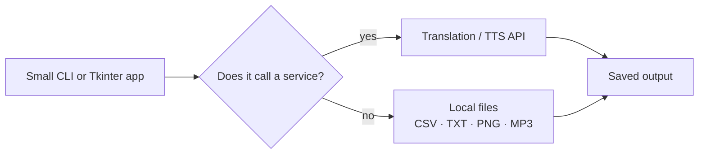

# Mini-Python-Projects


A toolbox of small, self-contained Python utilities. Each project lives in its own folder, runs on its own, and solves one everyday problem — from taking a clean screenshot to drilling German vocabulary.

## Projects

| Project | What it does | Highlights |
| --- | --- | --- |
| [`EasyScreenshot/`](EasyScreenshot) | Quick screenshot tool | Timestamped filenames, autostart configuration, hotkey helper |
| [`Encryption/`](Encryption) | Encrypt / decrypt text and files | Reusable `Encryption.py` / `Decryption.py` modules plus a Tkinter app |
| [`MiniTranslator/`](MiniTranslator) | Small translation app | Tkinter GUI over a translation API, German ↔ Persian focus |
| [`SortData/`](SortData) | Sorts numerical and textual data | Prepares and sorts CSV input (`preparing.py` + `Sort_Data.py`) |
| [`TextSeparation/`](TextSeparation) | Splits mixed text into parts | Reads `INPUT.txt`, writes the separated result to `OUTPUT.txt` |
| [`TextToMp3/`](TextToMp3) | Text-to-speech | `gTTS` output saved under `SavedFiles/<timestamp>/` |
| [`Typist(DE_FA)/`](Typist(DE_FA)) | Typing / dictation helper | German and Persian layouts, documentation in EN / DE / FA |
| [`WordQuestion/`](WordQuestion) | Vocabulary quiz | Random questions from `saved.txt`, answers stored back to the file |

## Layout



## Requirements

Python 3.9+ on Windows. Install what a given folder needs:

```bash
pip install pillow pyperclip gtts googletrans==4.0.0-rc1
```

Prebuilt `.exe` files are included for `EasyScreenshot`, `Encryption` and `MiniTranslator`.

## Run

```bash
python EasyScreenshot/screenshot.py
python MiniTranslator/MiniTranslator.py
python TextToMp3/Text_to_mp3.py
python "WordQuestion/word question.py"
```

Each folder also carries its own short `README` describing its inputs and outputs.

## License

MIT — see [LICENSE](LICENSE) where present. Contributions and small fixes are welcome.
